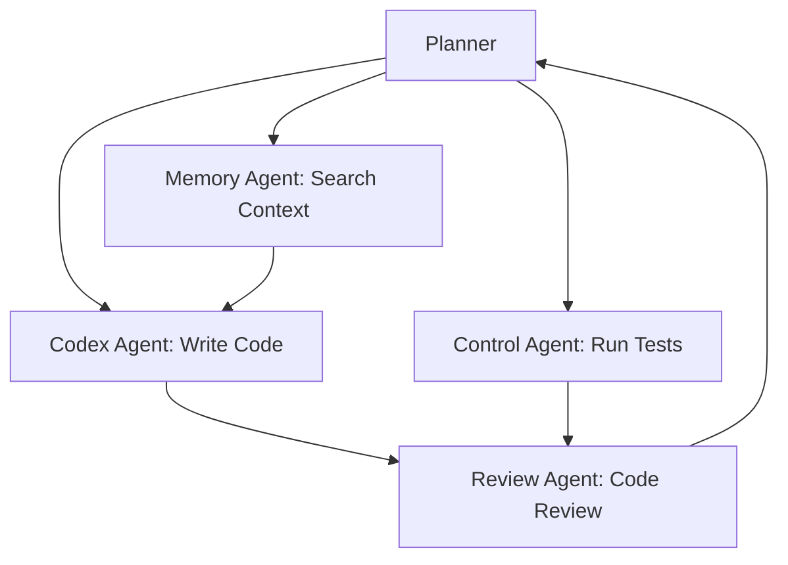

# SKILL.md
name: orion-planning
description: Use when autonomous planning/execution needed. LLM router, tool orchestration, goal decomposition.
category: orion
triggers: ["planning", "agent", "autonomy", "tool use", "goal", "execute", "orchestration"]

---

## Overview

ORION Planning provides autonomous goal achievement:
- **Goal Decomposition** — LLM breaks high-level goals into tool steps
- **Tool Router** — Maps steps to available tools (voice, control, memory, etc.)
- **Dependency Resolution** — Executes steps in topological order
- **Error Handling** — Retries, fallbacks, partial completion
- **Multi-Agent** — Spawns subagents for complex tasks (coding, research)

---

## Installation

```bash
# Build ORION core (includes planning)
cd /home/unk-/Orion/ORION/core
cargo build --release --workspace

# Download LLM model (Nemotron-3-Ultra or Llama-3.1-70B)
mkdir -p ~/.orion/models
# Using your existing NVIDIA model or local quantized
```

---

## Configuration

Edit `~/.config/orion/config.toml`:

```toml
[planning]
llm_model = "nvidia/nemotron-3-ultra"
max_context_tokens = 32768
temperature = 0.3
tool_timeout_ms = 30000
max_retries = 2
```

---

## API (via Message Bus)

### Publish: `orion.planning.plan`
Request a plan:
```json
{
  "goal": "Create a REST API for user management",
  "context": { "project_path": "~/Orion/my-api", "language": "rust" },
  "constraints": ["use axum", "add tests", "follow REST conventions"],
  "available_tools": ["orion-control", "orion-memory", "codex", "claude-code"]
}
```

### Subscribe: `orion.planning.plan_response`
Receive plan:
```json
{
  "steps": [
    {
      "tool": "orion-control",
      "args": {"action_type": "type", "params": {"text": "cargo new my-api"}},
      "depends_on": [],
      "description": "Create new Rust project"
    },
    {
      "tool": "codex",
      "args": {"prompt": "Implement user CRUD with axum", "files": ["src/main.rs"]},
      "depends_on": [0],
      "description": "Generate API code"
    }
  ],
  "reasoning": "Create project structure first, then implement endpoints",
  "estimated_duration_ms": 60000
}
```

### Publish: `orion.planning.execute`
Execute a plan (auto-runs after plan_response):
```json
{
  "plan": { ... },  // full plan response
  "context": { ... }
}
```

### Subscribe: `orion.planning.execution_result`
Step results:
```json
{
  "step_id": "step_1",
  "success": true,
  "result": {...},
  "duration_ms": 5000
}
```

---

## Available Tools (Standard)

| Tool | Description | Skill |
|------|-------------|-------|
| `orion-voice` | Speak, listen | orion-voice |
| `orion-control` | Click, type, screenshot | orion-control |
| `orion-memory` | Search, recall | orion-memory |
| `codex` | Code generation | codex skill |
| `claude-code` | Code features/PRs | claude-code skill |
| `opencode` | Code review | opencode skill |
| `web_search` | Web research | N/A |
| `browser` | Web automation | computer-use skill |

---

## Usage Examples

### From Hermes (Python)
```python
import asyncio
import async_nats
import json

async def achieve_goal(goal):
    nc = await async_nats.connect("nats://localhost:4222")
    
    # Request plan
    await nc.publish("orion.planning.plan", json.dumps({
        "goal": goal,
        "context": {},
        "constraints": [],
        "available_tools": ["orion-control", "orion-memory", "codex"]
    }).encode())
    
    # Get plan
    sub = await nc.subscribe("orion.planning.plan_response")
    async for msg in sub.messages:
        plan = json.loads(msg.data)
        print(f"Plan: {plan['reasoning']}")
        for i, step in enumerate(plan['steps']):
            print(f"  {i+1}. {step['description']} [{step['tool']}]")
        break
    
    await nc.close()

asyncio.run(achieve_goal("Find all TODO comments in my project and create a summary"))
```

### From Rust
```rust
use orion_core::*;

let nc = async_nats::connect("nats://localhost:4222").await?;
nc.publish("orion.planning.plan", serde_json::to_vec(&PlanRequest {
    goal: "Refactor the auth module to use JWT".into(),
    context: serde_json::json!({"path": "~/Orion/auth"}),
    constraints: vec!["no breaking changes".into(), "add tests".into()],
    available_tools: vec!["claude-code".into(), "orion-memory".into()],
})?.into()).await?;
```

---

## Multi-Agent Orchestration

For complex goals, the planner spawns subagents:



Each subagent runs in isolated context with delegated tools.

---

## Troubleshooting

| Issue | Fix |
|-------|-----|
| LLM hallucinates tools | Constrain `available_tools`, add examples to prompt |
| Plan loops infinitely | Check `depends_on` for cycles, add max_steps limit |
| Tool timeout | Increase `tool_timeout_ms`, check tool health |
| Context too large | Enable hierarchical summarization, reduce `max_context_tokens` |

---

## Performance Targets

| Metric | Target |
|--------|--------|
| Plan generation (5 steps) | < 3s |
| Tool routing | < 10ms |
| Subagent spawn | < 500ms |
| GPU VRAM (70B 4-bit) | ~8 GB |